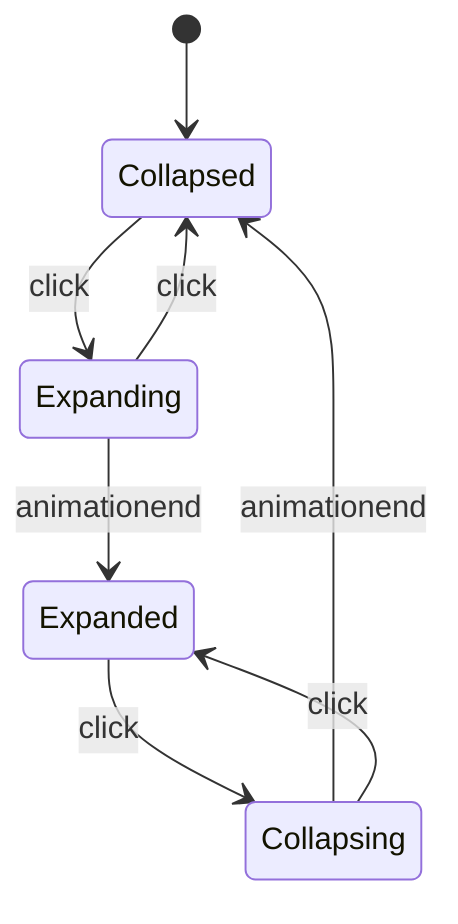

# Statechart Method

The reference for the statechart workflow: extraction heuristics, the enumeration
procedure, notation templates, the review-question protocol, test derivation, and
the pitfalls that break state machines in practice.

## 1. Extracting a machine from existing code

A state machine hides in code as three clusters. Find all three before naming anything:

- **States** — mutually exclusive situations. Suspects: boolean/flag clusters
  (`isOpening && !isExpanded` is a state), union/enum values, phases named in
  comments or variable names, the cases of a `switch` on status.
- **Events** — inputs that can arrive at any moment. Suspects: every handler,
  callback, promise continuation, timer/timeout, abort signal, network result,
  and repeated user clicks. An event is anything that can interrupt anything else.
- **Actions** — work done while moving between states (DOM writes, requests,
  cleanup). They ride on transitions, never on states.

Model what the code *does* before what it should do: the bug analysis in step 3 of
the workflow needs the machine as-is, so the matrix shows which cell the defect
lives in.

## 2. Enumeration procedure

1. Fix the event set first — it is the one that grows unnoticed. Ask "what else
   can arrive while this is happening?" until the answer is nothing.
2. Fix the state set. Merge any two states no event distinguishes.
3. Draw the full grid, every state × every event, including the initial state and
   terminal states.
4. Verdict every cell:
   - `→ Next` — legal transition, plus its action (or "—").
   - `∅` — deliberate no-op; note why (re-click during animation, duplicate
     delivery, stale response).
   - `✕` — forbidden; note what makes it unreachable (guard, structural
     impossibility). If nothing makes it unreachable, it is a bug to fix, not a
     cell to mark.
5. Walk each invariant against the grid: "a settled card never re-animates",
   "no request outlives its conversation". Every invariant must be readable as a
   yes/no against the matrix.

A blank cell or an unlisted event is unfinished work, not freedom.

## 3. Notation

Transition table (the standard the review and the tests check against):

| Current state | Event | Next state | Action | Verdict |
| --- | --- | --- | --- | --- |
| Collapsed | click | Expanding | start animation | legal |
| Expanding | click | Collapsed | cancel animation | legal |
| Expanding | animationend | Expanded | — | legal |
| Expanding | animationend (repeat) | Expanding | — | ∅ idempotent by timer |

Mermaid diagram — pi-web renders the fence inline; keep labels short:

````

````

Verdict marks may appear in the table column rather than the diagram; the diagram
shows legal flow, the table carries the full standard.

## 4. The review-question protocol

The review gate exists because some rows are policy, not engineering: two
defensible behaviors and the user owns the choice. Pick rows for the questions by:

- **User-owned semantics** — "Playing × play: ignore or restart?", "does closing
  discard the draft?".
- **Forbidden-vs-legal disputes** — a cell you marked `✕` that the product may
  actually want (`✕` → legal with a guard).
- **Missing scenarios** — offer one free-form line: "还有哪些场景要补进矩阵？".

Boundaries that keep the gate useful:

- One to three questions; each question at most twelve options; multiSelect when
  several rows can change together.
- Present the full table in the same reply — the questions reference rows of the
  table, so the user decides against the whole standard, not a fragment.
- End the turn after `ask_user_question`; a pending question is not permission to
  start coding.
- Mechanical consequences of an agreed row (guard placement, test scaffolding)
  are not questions; asking them wastes the gate.

When answers arrive: apply them to the table, re-enumerate the rows the change
touches (a changed cell can cascade into neighbors), then implement.

## 5. Test derivation

One row, one test, named after the row:

- Legal row → drive the state, fire the event, assert the destination state and
  the action's observable effect.
- No-op row → fire the event, assert nothing changed (no extra request, no
  animation restart, state unchanged).
- Forbidden row → assert the guard rejects, or — for structurally unreachable
  combinations — assert the type system/branch makes it unreachable (a compile
  exhaustiveness check counts).
- Invariant → one test that sweeps the matrix (or a property-based pass over the
  grid) and asserts the rule in every state.

Report the mapping row → test. Unverified rows are reported as unverified.

## 6. Pitfalls

- **Parallel booleans contradict.** `isOpening && isExpanded` can both be true;
  one state enum cannot. Refactor to a single discriminant when implementing.
- **Events during the transition.** The click that arrives while the animation
  runs is the classic bug; the `Expanding` state exists precisely to answer it.
- **Re-entry.** Firing the entry event of the current state (Playing × play) —
  decide it explicitly; the default should usually be `∅`.
- **Timeout vs user race.** A timeout and a click can both be valid; order them
  in the table (first one wins, the other becomes `∅`).
- **Terminal states need an explicit self-loop.** A state with no outgoing event
  is a deadlock in analysis terms; give terminal states their deliberate no-ops
  so the matrix says "settled" instead of "stuck".
- **Shadowed state.** A state variable and a leftover flag describing the same
  thing drift apart; the table is the chance to name one owner per fact.
